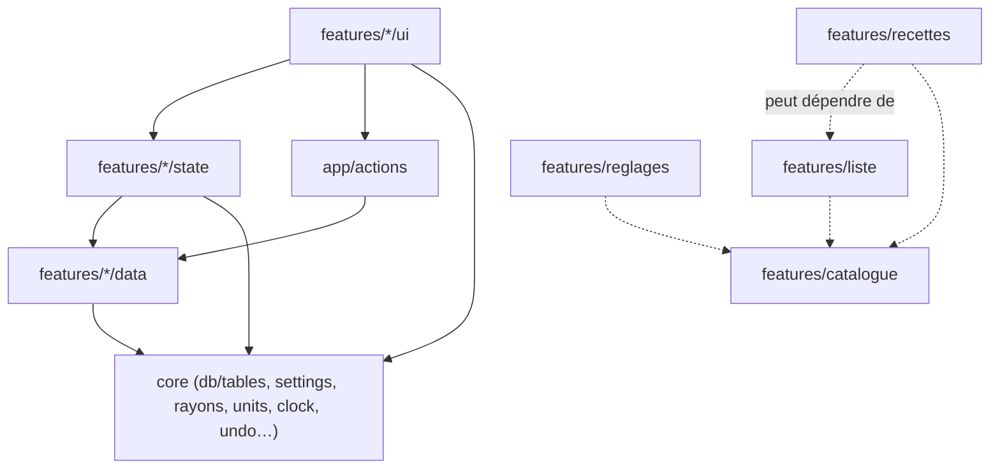
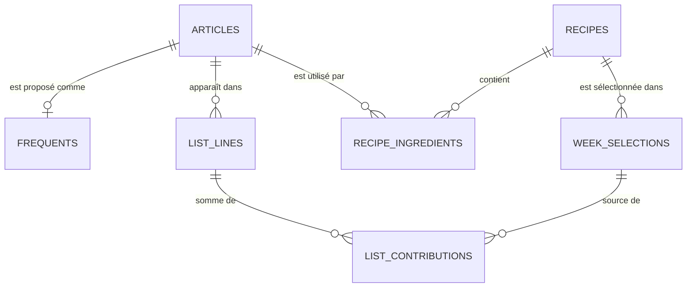
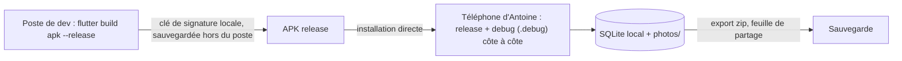

# Architecture Spine — grocery-list

## Design Paradigm

Couches par fonctionnalité, sur une base SQLite locale unique (Drift) qui fait foi. L'écran observe des requêtes réactives exposées par Riverpod ; il ne garde aucune copie des données persistées. Toute écriture passe par le repository du propriétaire, dans une transaction. Les opérations qui touchent plusieurs fonctionnalités vivent dans `lib/app/actions/`.

| Couche | Dossier | Rôle |
|---|---|---|
| Présentation | `lib/features/<f>/ui/` | Écrans et widgets M3 ; lit des providers, appelle des actions ou des repositories |
| État | `lib/features/<f>/state/` | Providers Riverpod qui exposent les flux Drift et les commandes |
| Données | `lib/features/<f>/data/` | Repository et requêtes de la fonctionnalité, sur ses tables |
| Actions transverses | `lib/app/actions/` | Opérations sur plusieurs fonctionnalités, en une transaction |
| Noyau | `lib/core/` | Base Drift et définitions de toutes les tables, réglages, rayons, unités, horloge, thème, pictos, Annuler, chaînes, routeur, sauvegarde |

## Invariants & Rules



Flèches pleines : sens de dépendance entre couches ; `core` ne dépend d'aucune fonctionnalité. Flèches pointillées : seules dépendances permises entre fonctionnalités. `liste` ne dépend jamais de `recettes` ; `catalogue` ne dépend d'aucune autre fonctionnalité ; toutes lisent `core/settings`.

### AD-1 — Base unique, réactive, écrite par le propriétaire [ADOPTED]

- **Binds:** all
- **Prevents:** un écran ou un epic qui garde son propre état des données et diverge de la base ; deux chemins d'écriture pour une même table.
- **Rule:** une seule `AppDatabase` Drift dans `lib/core/db/`, et toutes les définitions de tables dans `lib/core/db/tables/`. Chaque table a un seul propriétaire (AD-2) ; seul son repository l'écrit. L'UI lit par des flux `watch` exposés en providers et n'écrit jamais en direct. Seul état d'écran admis : le brouillon de la Revue (cases décochées, quantités corrigées), transitoire, jamais persisté ni exporté.

### AD-2 — Propriétaire de chaque donnée [ADOPTED]

- **Binds:** R1–R22
- **Prevents:** deux epics qui écrivent la même table avec des règles différentes ; une fonctionnalité qui doit importer une autre interdite pour lire un réglage.
- **Rule:** `catalogue` possède `articles` et `frequents` ; `liste` possède `list_lines` et `list_contributions` ; `recettes` possède `recipes`, `recipe_ingredients` et `week_selections` ; `core/settings` possède `settings`, une seule ligne à id fixe : ordre du parcours (les 13 codes d'AD-11 dans l'ordre), groupement, Écran allumé, drapeau de premier lancement, `seed_version` par fichier. L'epic 1 crée `core/settings` avec ses valeurs par défaut ; `reglages` n'a que l'UI et écrit par le `SettingsRepository`. L'epic 3 modifie articles et fréquents par le repository `catalogue` de l'epic 1.

### AD-3 — Actions transverses en une transaction [ADOPTED]

- **Binds:** R4, R5, R6, R8, R12
- **Prevents:** `liste` qui importe `recettes` pour remettre la sélection à zéro ; un état à moitié appliqué si une étape échoue.
- **Rule:** Ajouter à la liste (Revue), désélectionner une recette validée, Nouvelle liste et Terminer les courses sont des actions de `lib/app/actions/`. Chacune appelle les repositories concernés dans une seule transaction Drift. L'epic 1 crée Terminer les courses (vider la liste) ; l'epic 2 y ajoute la remise à zéro de la sélection dans la même action.

### AD-4 — Ligne de liste et contributions (provenance) [ADOPTED]

- **Binds:** R4, R5, R6, R9, R10, R11, R13, R16, R17, R25, R26, R28
- **Prevents:** une liste qui ne stocke que le total et que l'epic 2 doit refaire ; deux epics qui ajoutent différemment à une ligne cochée ou retirent différemment un article.
- **Rule:**
  - Une ligne active non cochée est unique pour (`article_id`, `unit_key`), où `unit_key` vaut l'unité ou `-` sans quantité. Une ligne cochée n'est jamais complétée : une contribution dont la seule ligne correspondante est cochée crée une nouvelle ligne non cochée. Décocher une ligne qui a un jumeau non coché la fusionne dans ce jumeau.
  - La quantité d'une ligne n'est jamais stockée : c'est la somme des contributions actives (`deleted_at IS NULL`). La suppression d'une source (recette, sélection) ne désactive jamais une contribution.
  - Une contribution porte sa source : `week_selection_id` (recette validée), `ajout` (Panneau +) ou `edition` (AD-5). Une contribution sans quantité rejoint une ligne non cochée existante de l'article, quelle que soit son unité ; une contribution chiffrée rejoint la ligne de son unité, sinon la ligne sans quantité de l'article, qui prend alors cette unité.
  - `added_at` est fixé à la création de la ligne et ne change jamais ; il ordonne la liste sans groupement et les lignes dans un rayon.
  - « Dans la liste » (état d'un fréquent ou d'un résultat) se calcule : il existe une ligne active non cochée de l'article. Un tap qui retire supprime toutes les lignes non cochées de l'article avec leurs contributions, comme un glisser, et s'annule de même.
  - En Revue, une ligne corrigée qui fusionne plusieurs recettes est répartie entre elles au prorata de leurs quantités d'origine, arrondie dans l'unité, la dernière recette absorbant le reste ; une ligne décochée ne crée aucune contribution.

### AD-5 — Ligne manuelle [ADOPTED]

- **Binds:** R6, R13, R25, R26, R28
- **Prevents:** deux façons de stocker le mode manuel ; une désélection qui modifie une ligne corrigée à la main ; deux lignes non cochées du même article dans la même unité après un changement d'unité.
- **Rule:** la Feuille d'édition d'article (Liste), la popup quantité (Panneau +) et Entrée avec un tag quantité sur un article déjà dans la liste éditent la quantité d'une ligne par un seul chemin du repository `liste`. Corriger la quantité ou l'unité supprime, dans une transaction, toutes les contributions actives de la ligne, insère une contribution `edition` de la valeur et de l'unité saisies (vide = sans quantité) et fixe `list_lines.manual_at`. Si une autre ligne non cochée du même article a déjà ce `unit_key`, ses contributions actives passent sur la ligne éditée, qui garde son `added_at`, et elle est supprimée logiquement. Une recette validée ensuite ajoute encore sa contribution. Désélectionner une recette retire ses contributions des seules lignes non cochées et sans `manual_at`. Une ligne qui n'a plus de contribution active est supprimée (logiquement). Une contribution `ajout` ne rend pas la ligne manuelle, même chiffrée par le tag Quantité à l'ajout.

### AD-6 — Unités sans conversion [ADOPTED]

- **Binds:** R11
- **Prevents:** une fusion différente entre la Liste et la Revue ; deux codages de « sans quantité » ; des erreurs d'arrondi sur les sommes.
- **Rule:** unités stockées `g`, `ml`, `piece`. `kg` et `L` sont seulement des unités de saisie, converties ×1000 en `g` et `ml` par une seule fonction de `lib/core/units/` ; aucun autre code d'unité n'entre en base. Quantité et unité sont nulles ensemble, et seulement ensemble (« sans quantité ») ; une quantité saisie à 0 vaut « sans quantité ». Les quantités sont des entiers : grammes, millilitres, ou millièmes de pièce. Un article dans deux unités donne deux lignes. La conversion pour la lecture (1,5 kg, 20 cl, ½) est faite par une seule fonction de `lib/core/units/`, à l'affichage seulement.

### AD-7 — Données prêtes pour la synchro [ADOPTED]

- **Binds:** C3, R21
- **Prevents:** des tables impossibles à fusionner à l'import ou à synchroniser en V2 ; un horodatage qui recule.
- **Rule:** chaque table a `id` (UUID, texte, clé primaire), `updated_at` et `deleted_at` (entiers, millisecondes UTC, `deleted_at` nullable). Aucune suppression physique ; toute lecture filtre `deleted_at IS NULL`. Toute écriture passe par l'horloge de `lib/core/clock/` : `updated_at = max(maintenant, ancien updated_at + 1)`. Les données créées par l'utilisateur ont un UUID v4 ; les lignes à clé naturelle (réglages, fréquents) ont l'id fixé par AD-2 et AD-17. Une ligne dont le parent est supprimé compte comme supprimée ; le parent d'une contribution est sa ligne, pas sa source.

### AD-8 — Contenu fourni [ADOPTED]

- **Binds:** R18, R20, R22
- **Prevents:** des doublons ou des modifications perdues après un import ; des recettes exemples jamais insérées sur un téléphone qui tournait déjà l'epic 1.
- **Rule:** articles, fréquents et recettes exemples sont des assets JSON de `assets/seed/`, chacun avec un `seed_version` et des UUID définitifs : régénérer le contenu garde l'UUID de chaque élément existant. Le chargeur unique de `lib/core/db/seed/` tourne à chaque démarrage : pour chaque fichier dont la version dépasse le `seed_version` des réglages, il insère les UUID absents (une ligne supprimée compte comme présente) et ne met jamais à jour une ligne existante. Lignes fournies et réglages par défaut ont `updated_at = 0`, pour qu'une modification de l'utilisateur l'emporte toujours à l'import. Le chargement se fait en une transaction ; un échec affiche un écran d'erreur bloquant. Un article fourni dont le nom normalisé est déjà porté par un article hors catalogue (AD-17) est réconcilié comme à l'import (AD-9) : l'article fourni est gardé et les références y sont reportées.

### AD-9 — Sauvegarde : format et fusion à l'import [ADOPTED]

- **Binds:** R21
- **Prevents:** un export qui oublie une table ou les photos ; un import qui écrase, duplique ou échoue sur une contrainte.
- **Rule:**
  - L'export est une archive zip : `data.json` (`{ "format_version": n, "exported_at": ms, "tables": { "<table>": [lignes] } }`, toutes les tables, lignes supprimées comprises) et `photos/`. `format_version` suit le `schemaVersion` d'AD-14 ; un fichier d'une version antérieure connue est migré, une version inconnue ou un fichier invalide est refusé sans rien modifier.
  - L'import, en une transaction : copie des photos manquantes, fusion ligne par ligne par `id` dans l'ordre des dépendances (articles, recettes, ingrédients, sélections, lignes, contributions, fréquents, réglages), la ligne au `updated_at` le plus récent l'emportant, la ligne locale en cas d'égalité. Puis chaque propriétaire réconcilie ses doublons de clé naturelle (articles de même nom normalisé, lignes non cochées de même (`article_id`, `unit_key`), sélections de la même recette), en reportant les références sur la ligne gardée.
  - Un test vérifie que les tables exportées sont exactement celles de la base ; la story qui crée une table l'ajoute à l'export.

### AD-10 — Annuler [ADOPTED]

- **Binds:** R6, R12, R13, R16, C9
- **Prevents:** un mécanisme d'annulation différent par epic ; un Annuler qui écrase une écriture plus récente.
- **Rule:** une action annulable remet au service `Undo` de `lib/core/undo/`, pour chaque table qu'elle écrit, l'état d'avant de chaque ligne touchée (ou « absente »). Annuler réécrit cet état dans une transaction, avec un `updated_at` neuf ; une ligne créée par l'action est supprimée logiquement. Le service n'a qu'un emplacement : il est vidé par toute autre écriture (y compris un import) et par la fin du snackbar.

### AD-11 — Rayons figés dans le code [ADOPTED]

- **Binds:** R9, R19, C5
- **Prevents:** des rayons dupliqués entre le code et la base, ou nommés différemment selon l'epic.
- **Rule:** les 13 rayons sont une énumération de `lib/core/rayons/`, avec un code stable chacun (`fruits-legumes`, `boulangerie`, `viande-poisson`, `cremerie`, `epicerie-salee`, `epicerie-sucree`, `surgeles`, `plats-prepares`, `boissons`, `hygiene`, `entretien`, `bebe-animaux`, `divers`), leur nom affiché et leur token de couleur. La base ne stocke que ces codes (rayon d'un article, d'une ligne, ordre du parcours dans `settings`).

### AD-12 — Thème depuis les tokens [ADOPTED]

- **Binds:** C5, C6
- **Prevents:** de l'argile ou des hex écrits en dur dans des écrans, hors des usages autorisés par DESIGN.md.
- **Rule:** `lib/core/theme/` construit seul les `ThemeData` clair et sombre depuis les tokens de DESIGN.md (`ColorScheme.fromSeed` sur `primary`, puis surcharges ; `surfaceTint` transparent). Les couleurs de rayon sont une `ThemeExtension`. Aucun hex hors de ce dossier ; un composant lit sa couleur dans le thème.

### AD-13 — Navigation [ADOPTED]

- **Binds:** R3, R4, R9, R22
- **Prevents:** deux epics qui naviguent différemment, perdent l'état des onglets ou décident chacun de l'onglet d'ouverture.
- **Rule:** go_router dans `lib/core/router/`. Un `StatefulShellRoute` à deux branches, Recettes et Liste, qui gardent leur état. Revue, Fiche recette, Paramètres et ses sous-écrans sont des routes poussées. L'app s'ouvre sur Liste, sauf au premier démarrage qui suit l'insertion des recettes exemples : le chargeur d'AD-8 lève alors le drapeau de premier lancement de `settings`, l'app s'ouvre sur Recettes et baisse le drapeau. Les feuilles modales s'ouvrent sur le navigateur racine et ne s'empilent jamais. La popup quantité n'est pas une feuille : une route légère du navigateur racine, placée au-dessus du Panneau +, qui reste ouvert dessous et dont le messager affiche ses erreurs.

### AD-14 — Migrations du schéma [ADOPTED]

- **Binds:** all
- **Prevents:** un epic qui recrée la base et efface la vraie liste d'Antoine en ajoutant ses tables.
- **Rule:** un seul `schemaVersion` dans `lib/core/db/`. Chaque story qui change le schéma l'incrémente et ajoute une étape de migration, jamais destructive. Chaque version est figée par `drift_dev` (dump du schéma) et chaque étape a son test de migration. La version 2 ajoute `articles.in_catalogue` (vrai pour les articles existants, AD-17).

### AD-15 — Copie à la création [ADOPTED]

- **Binds:** R7, R13, R17, R18, R25, R28
- **Prevents:** une modification d'article (epic 3) qui déplace des lignes ou change l'unité des recettes existantes.
- **Rule:** une ligne copie le rayon de l'article à sa création (le Choix de rayon ou la Feuille d'édition le changent ensuite) ; un ingrédient de recette copie l'unité de l'article à son ajout. Le tag Rayon du Panneau + ne change que la ligne, jamais l'article, hors catalogue compris : une ligne libre ajoutée de nouveau repart de Divers. Modifier un article ne réécrit jamais une ligne ou un ingrédient existant ; cela vaut pour les ajouts suivants. La Revue groupe par le rayon actuel de l'article.

### AD-16 — Cycle de vie de la sélection [ADOPTED]

- **Binds:** R3, R4, R5, R6, R8, R12
- **Prevents:** une recette « validée » sans contribution qu'on ne peut plus revalider ; une sélection réutilisée qui retire d'anciennes contributions.
- **Rule:** chaque sélection d'une recette crée une nouvelle ligne `week_selections`, jamais réactivée sauf par Annuler. Désélection, Terminer les courses et Nouvelle liste la suppriment logiquement. `validated_at` n'est fixé que par Ajouter à la liste, dans sa transaction, pour toutes les recettes de cette Revue, même sans ligne cochée ; quitter la Revue ne valide rien.

### AD-17 — Identité d'un article et des fréquents [ADOPTED]

- **Binds:** R16, R17, R18, R20, R25
- **Prevents:** « tomate », « Tomate » et « Tomates » créés par trois chemins différents ; un texte tapé dans le Panneau + qui grossit le catalogue ; deux identités de ligne de liste (article ou texte libre) ; des fréquents dupliqués ou réordonnés.
- **Rule:** `catalogue` expose une seule `normalizeName` (espaces retirés, minuscules, sans accents). Un nom normalisé est unique parmi les articles actifs, hors catalogue compris. Un article porte `in_catalogue` : seuls les articles du catalogue sortent dans la recherche et dans Paramètres › Articles. Le texte validé par Entrée dans le Panneau + passe par une seule `resolveTypedArticle(nom)` : l'article actif de ce nom normalisé, sinon un nouvel article hors catalogue (Divers, sans unité) ; une ligne libre est donc une ligne d'un article hors catalogue, et AD-4 s'applique tel quel. `createArticle(nom, rayon = divers, unité = sans)` ne sert qu'à créer au catalogue (Paramètres › Articles, et la Fiche recette selon l'epic 2) ; créer un nom porté par un article hors catalogue le fait entrer au catalogue, même id. Un fréquent par article, d'id dérivé de l'article (UUID v5) ; il est réactivé s'il est ajouté de nouveau ; `position` ordonne les fréquents d'un rayon, un fréquent ajouté ou déplacé passant en dernier.

### AD-18 — Pictos et photos [ADOPTED]

- **Binds:** R1, R2, R21, C7
- **Prevents:** trois epics qui référencent les pictos différemment avant le choix du pack ; des photos perdues à la restauration.
- **Rule:** un article porte une `picto_key` stable (kebab-case). Un seul résolveur dans `lib/core/pictos/` la traduit en asset, avec un repli neutre teinté du rayon ; changer de pack ne change que le résolveur et les assets. La photo d'une recette est copiée, réencodée et plafonnée en taille, dans `photos/<uuid>.jpg` du dossier documents de l'app ; la table ne stocke que ce nom. `recettes` écrit les photos, `core/backup` les exporte.

### AD-19 — Liste révélée derrière le Panneau + [ADOPTED]

- **Binds:** R15, R25, R27
- **Prevents:** une course entre l'écriture et le flux de la Liste ; une copie des lignes côté panneau ; un panneau et une Liste qui se pilotent chacun à leur façon.
- **Rule:** le panneau et la Liste ne partagent qu'un objet de `features/liste/state` : position du haut du panneau et demande de montrer une ligne existante. Aucune donnée persistée n'y passe (AD-1). Tant que le panneau est ouvert, la Liste repère elle-même toute ligne nouvelle sur son flux, l'anime et la montre ; seule Entrée sur une ligne déjà présente en fait la demande. Le défilement se calcule sur la zone libre au-dessus du panneau et ne bouge rien si la ligne y est déjà.

## Consistency Conventions

| Concern | Convention |
| --- | --- |
| Naming | Fichiers en `snake_case.dart` ; tables Drift au pluriel en anglais (`articles`, `frequents`, `list_lines`, `list_contributions`, `recipes`, `recipe_ingredients`, `week_selections`, `settings`) ; un repository par propriétaire, `<Feature>Repository` |
| Données & formats | UUID en texte ; dates en millisecondes UTC (entier) ; unités `g`, `ml`, `piece` ou nulles ; quantités entières (AD-6) ; rayons par leur code (AD-11) |
| Textes | Toute la microcopie française dans `lib/core/strings/strings_fr.dart`, reprise de Voice and Tone d'EXPERIENCE.md ; aucun texte d'interface en dur dans un widget |
| Erreurs | Une écriture qui échoue annule sa transaction et s'affiche en snackbar ; un échec d'ouverture de la base ou du contenu fourni affiche un écran d'erreur bloquant ; pas de journalisation distante, pas d'accès réseau (C2) |
| Tests | Tests unitaires de chaque repository et action sur une base Drift en mémoire ; un test de widget par écran ; un test de migration par étape (AD-14) ; un test qui interdit les imports de `features/recettes` depuis `features/liste` et de toute fonctionnalité depuis `core` ; tests d'intégration des six parcours d'EXPERIENCE.md dans l'epic 3 |
| Accessibilité | Chaque geste (glisser, appui long, glisser-déposer) a une action `Semantics` équivalente ; animations coupées si `MediaQuery.disableAnimations` ; cibles d'au moins 48 dp (C8, R24) |
| Dépendances | Material s'importe seulement par `package:material_ui/material_ui.dart`, jamais `package:flutter/material.dart` (migration par `dart fix --apply --code=migrate_design_widgets` dans la première story) ; base ouverte par `driftDatabase` de drift_flutter ; ni `sqlite3_flutter_libs` ni contournement sqlite3 ; dates en colonnes entières, jamais `dateTime()` ; tests de widgets avec `closeStreamsSynchronously: true` |
| Livraison | `applicationId` de release fixe ; la release est signée par la clé locale (le modèle `flutter create` signe avec la clé de debug) ; le debug utilise `applicationIdSuffix ".debug"` et coexiste avec la release sur le téléphone ; la clé de signature est hors dépôt et sauvegardée hors du poste ; un export avant chaque installation de release |

## Stack

| Name | Version |
| --- | --- |
| Flutter (canal stable) | 3.47.8 |
| Dart | 3.13.7 |
| drift | 2.35.3 |
| drift_flutter | 0.3.1 |
| drift_dev | 2.35.2 |
| build_runner | 2.16.2 |
| flutter_riverpod | 3.4.3 |
| go_router | 18.1.1 |
| uuid | 4.6.0 |
| material_ui | 1.8.0 |
| Android (cible) | téléphone, APK release signé localement |

## Structural Seed

```text
grocery-list/
  lib/
    main.dart
    app/
      actions/        # AD-3
    core/
      db/             # AppDatabase, tables/ (AD-1), migrations (AD-14), seed/ (AD-8)
      settings/       # AD-2 : réglages et parcours
      rayons/         # AD-11
      units/          # AD-6
      clock/          # AD-7
      theme/          # AD-12
      pictos/         # AD-18
      undo/           # AD-10
      router/         # AD-13
      strings/        # strings_fr.dart
      backup/         # AD-9
    features/
      catalogue/      # articles, fréquents, recherche, création (AD-17)
      liste/          # Liste, Panneau +, coche, Cochés
      recettes/       # Recettes, Fiche recette, Revue, sélection, photos
      reglages/       # écrans Paramètres (UI seulement)
  assets/
    seed/             # articles.json, frequents.json, recettes.json
  test/
  integration_test/
```





Environnements : un poste de développement et le téléphone d'Antoine. Pas de backend, pas de réseau, pas de compte en V1.

## Capability → Architecture Map

| Capability / Area | Lives in | Governed by |
| --- | --- | --- |
| R1, R2 recettes, photo, repli | `features/recettes` | AD-15, AD-17, AD-18 |
| R3 sélection ; R7 recette validée modifiée ou supprimée | `features/recettes` | AD-4, AD-16 |
| R4, R5 Valider, Revue, Ajouter à la liste | `features/recettes` + `app/actions` | AD-1, AD-3, AD-4, AD-6, AD-16 |
| R6 désélection d'une recette validée | `app/actions` | AD-3, AD-4, AD-5, AD-10, AD-16 |
| R8 Nouvelle liste ; R12 Terminer les courses | `app/actions` | AD-3, AD-10, AD-16 |
| R9, R10, R11, R13 Liste, coche, unités, édition | `features/liste` | AD-4, AD-5, AD-6, AD-10, AD-11, AD-15 |
| R14 Écran allumé ; R19 parcours | `core/settings` + `features/reglages` | AD-2, AD-11 |
| R15, R16, R17 Panneau +, fréquents, recherche | `features/liste` + `features/catalogue` | AD-4, AD-10, AD-17 |
| R25 Entrée ajoute le texte tapé ; R26 tag et popup quantité ; R28 tags du champ | `features/liste` + `features/catalogue` + `app/actions` | AD-4, AD-5, AD-13, AD-15, AD-17 |
| R27 ajout visible dans la Liste | `features/liste` | AD-1, AD-19 |
| R18, R20 catalogue et fréquents | `features/catalogue` + `core/db/seed` | AD-2, AD-8, AD-15, AD-17 |
| R21 export et import | `core/backup` | AD-7, AD-9, AD-14, AD-18 |
| R22 premier lancement | `core/db/seed` + `core/router` | AD-8, AD-13 |
| R23 états vides, microcopie | chaque `ui/` | Convention Textes |
| R24 accessibilité | chaque `ui/` | Convention Accessibilité |
| C2 local, permissions | toute l'app | Convention Erreurs ; paquets photo sans permission de stockage au-delà de la galerie et de l'appareil photo |
| C3 synchro future | toutes les tables | AD-7, AD-8, AD-9 |
| C5, C6, C7 thème, argile, pictos | `core/theme`, `core/pictos` | AD-12, AD-18 |

## Deferred

- **Synchro V2 et backend** : hors périmètre ; AD-7, AD-8 et AD-9 suffisent à la préparer.
- **Play Store, intégration continue** : reportés tant que l'app ne sert qu'à Antoine.
- **Pack de pictos** : choix et licence reportés (ticket) ; AD-18 isole la décision dans le résolveur.
- **Paquets propres à un seul epic** (photo, maintien de l'écran, partage et sélecteur de fichier) : choisis et versionnés par l'epic propriétaire du touch point, dans le respect de C2.
- **Générateur de code Riverpod** : au choix de la première story de l'epic 1, puis gardé pour tout le projet ; `build_runner` reste en 2.16.2 tant que `riverpod_generator` n'accepte pas `build` 5.
- **Articles hors catalogue** : jamais purgés en V1 ; leur affichage ou nettoyage dans Paramètres › Articles se décide avec l'epic 3.
- **Colonnes non citées** : fixées par le code ; les colonnes nommées dans AD-2, AD-4 à AD-8, AD-16 à AD-18 sont des invariants.
